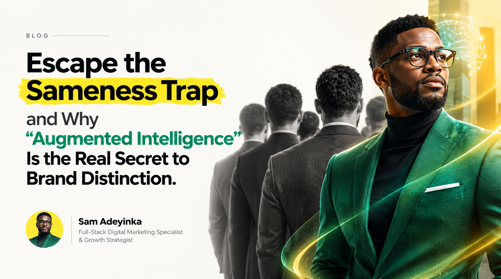
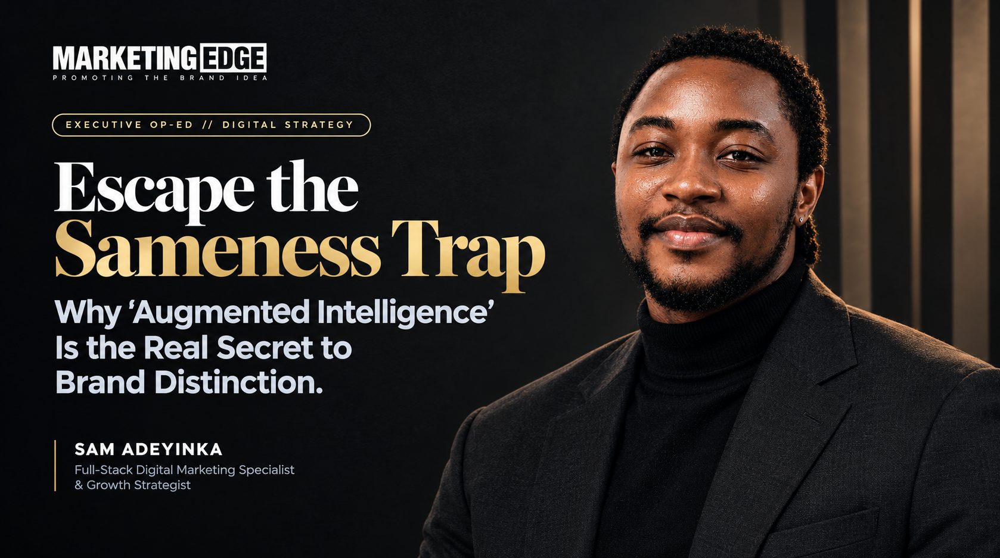
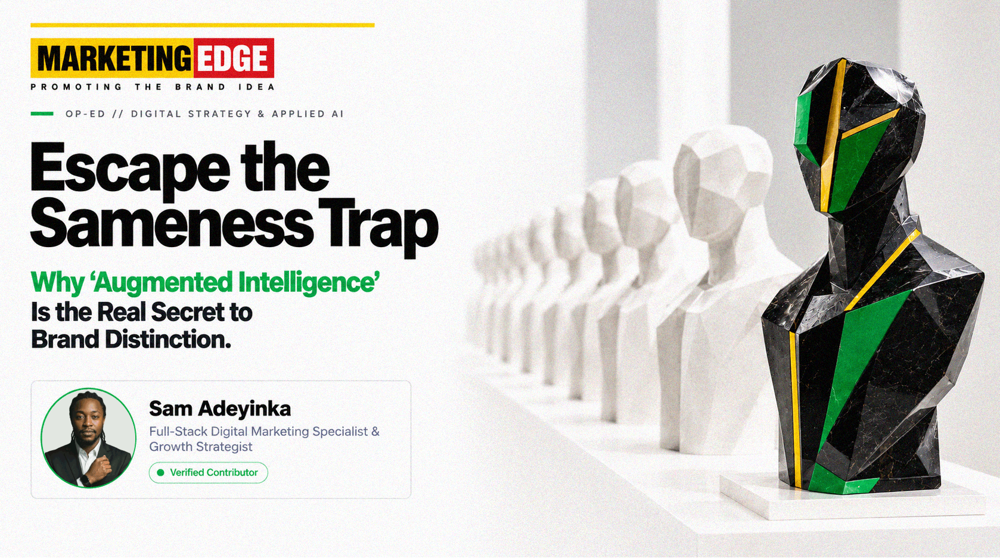

# Augmented Intelligence & Generative AI Brand Distinction Framework

> **A 3-Stage Empirical Benchmark on Eliminating Algorithmic Sameness in Enterprise Digital Media**  
> **By Sam Adeyinka** | Full-Stack Digital Marketing Specialist & Growth Strategist  
> *Companion Research to my Marketing Edge Op-Ed:* **"Escape the Sameness Trap and Why 'Augmented Intelligence' Is the Real Secret to Brand Distinction"**

---

## 1. Why I Built This Benchmark

If you spend five minutes scrolling through LinkedIn, X, or modern digital ads, you already know the problem: **everyone is publishing the exact same generic digital vanilla.**

When marketing teams and founders feed lazy, single-sentence prompts into tools like ChatGPT, Midjourney, or Claude, the models do what they are mathematically programmed to do: they average out the internet and give you the most predictable, plastic output possible. You get synthetic skin, cheesy floating glowing brains, and captions that read like a corporate robot.

In my recent feature for *Marketing Edge Magazine*, I argued that the solution isn't running away from AI, nor is it writing longer fluffy prompts. The solution is shifting from **Artificial Intelligence** (passive prompt consumption) to **Augmented Intelligence** (active human creative direction, exact brand DNA, and strict physical constraints).

To prove this point, I ran a controlled, 3-stage empirical test inside ChatGPT to generate an editorial cover graphic for my article. Here is the raw, unedited breakdown of what happened across all three stages.

---

## 2. The 3-Stage Visual Progression

### Stage 1: The Baseline Prompt (The Algorithmic Slop)
* **What I Prompted:** A standard, unconstrained single-sentence request.
* **The Raw Prompt:** [01_stage_1_basic_prompt.txt](01_stage_1_basic_prompt.txt)



* **My Diagnosis:**
  * **Cheesy AI Clichés:** The model immediately hallucinated every tired tech trope in the book: a floating translucent brain by the subject's ear, a glowing neon Tron loop around the waist, and a tacky yellow highlighter smear across the headline.
  * **Lazy Metaphor:** It drew a literal, anonymous line of faceless clones staring backward like a cheap stock photo.
  * **The Double-Avatar Glitch:** Plastic skin, a synthetic polyester suit, and an awkward layout where I was drawn as both the giant model and a tiny corner circle.
  * **Zero Commercial Weight:** It slapped a tiny `"BLOG"` tag at the top, completely missing the executive authority of *Marketing Edge*.

---

### Stage 2: The Uncalibrated High-Tech Prompt (The Ego Trap)
* **What I Prompted:** A highly technical brief with Hasselblad camera optics, medium-format physics, and lighting rules, but without strict brand guidelines or conceptual separation.
* **The Raw Prompt:** [02_stage_2_uncalibrated_advanced_prompt.txt](02_stage_2_uncalibrated_advanced_prompt.txt)



* **My Diagnosis:**
  * **The Ego Headshot Mistake:** The technical quality jumped 10x (the wool blazer weave and natural skin pores looked photographic), but the model mistook me for the visual subject of the article. It turned a strategic thought leadership piece into a personal portrait flyer.
  * **Off-Brand Colors:** The AI hallucinated champagne gold accents, which looks slick but completely ignores *Marketing Edge's* actual brand identity.
  * **Missing the Core Message:** It looked like a fashion cover, but it failed to visually communicate the tension between *The Sameness Trap* and *Brand Distinction*.

---

### Stage 3: The Calibrated Augmented Intelligence System (The Masterwork)
* **What I Prompted:** A 15-parameter Creative Director brief locking in *Marketing Edge’s* exact design DNA, strict negative constraints, a 1:1 circular contributor avatar, and a museum-grade physical art metaphor.
* **The Raw Prompt:** [03_stage_3_master_augmented_prompt.txt](03_stage_3_master_augmented_prompt.txt)



* **Why This Won:**
  * **A True Editorial Metaphor:** Instead of cartoon brains or literal clones, I directed the model to build a gallery-grade physical sculpture on a clean white plinth. A receding row of blank, identical white geometric busts represents *The Sameness Trap*, while a single, hand-faceted obsidian and emerald-green sculpture commands the foreground, proving *Brand Distinction*.
  * **Pixel-Perfect Brand DNA:** Exact matches for *Marketing Edge’s* live digital identity: Canary Yellow (`#FFD500`) top bar and logo box, Deep Crimson (`#990000`) "EDGE" box, and Signature Green (`#1EB53A`) on *‘Augmented Intelligence’*.
  * **Architectural Typography:** Disciplined Swiss grotesque lettering with a 150px breathing buffer, so the text never crowds the artwork.
  * **Executive Restraint:** My portrait sits in a clean, circular contributor badge in the bottom-left corner with my verified title, exactly how columnists appear in *Wired*, *Fast Company*, or *Harvard Business Review*.

---

## 3. The 5 Rules I Use to Eliminate AI Slop

When I direct applied generative AI workflows for brands, I enforce five non-negotiable guardrails:

1. **Lock Camera & Sensor Physics:** Never ask for a "cool image." Specify optical focal lengths (80mm f/2.8), medium-format sensors (Hasselblad H6D), directional key lighting, and shallow depth of field to kill synthetic CGI gloss.
2. **Build Negative Constraint Armor:** Explicitly forbid the model's default crutches: glowing neon loops, floating holographic brains, waxy skin smoothing, and cartoon lighting.
3. **Enforce Exact Hexadecimal Tokens:** Feed the model exact brand hex codes (`#FFD500`, `#1EB53A`, `#111111`) tied to specific UI elements rather than letting it guess colors.
4. **Elevate the Metaphor:** Steer the model away from literal cartoon drawings toward physical, sculptural, or architectural art forms that treat your audience like intelligent adults.
5. **Separate the Strategist from the Idea:** Unless the piece is an interview about you, never make yourself the hero image. Let the concept take center stage, and position your credentials with editorial dignity.

---

## 4. Repository Structure

```text
├── README.md                                          # Empirical benchmark documentation
├── LICENSE                                            # MIT Open-Source License
├── 01_stage_1_baseline_prompt_slop.png               # Baseline output (The Slop)
├── 02_stage_2_uncalibrated_advanced_prompt.png       # Technical output (The Ego Trap)
├── 03_stage_3_augmented_intelligence_masterpiece.png # Calibrated masterwork (Distinction)
├── 01_stage_1_basic_prompt.txt                       # Raw baseline prompt
├── 02_stage_2_uncalibrated_advanced_prompt.txt       # Uncalibrated technical prompt
└── 03_stage_3_master_augmented_prompt.txt            # Master augmented prompt

```

---

## 5. Author & Industry Profile

**Sam Adeyinka**  
*Full-Stack Digital Marketing Specialist & Growth Strategist*  
* Second Brain & Systems: Applied Generative AI Workflows, High-Ticket Funnels & Media Buying
* Email: [samknowsfunnels@gmail.com](mailto:samknowsfunnels@gmail.com)  
* Phone / WhatsApp: `+234 816 164 6027`  
* Portfolio: [sam-marketing-portfolio.lovable.app](https://sam-marketing-portfolio.lovable.app/)  
* LinkedIn: [linkedin.com/in/thatsamadeyinka](https://www.linkedin.com/in/thatsamadeyinka/)  

---

## 6. License & Open-Source Usage

This benchmark and prompt architecture are released under the [MIT License](LICENSE). Digital marketing specialists, agency creative directors, and researchers are encouraged to fork, adapt, and cite this framework for enterprise generative campaigns.
